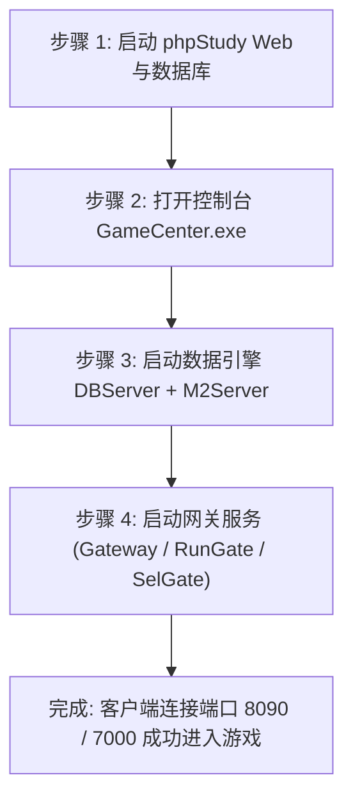

# SKILL-01: GOD引擎一键架设与服务端启动实战指南

## 技能定位
指导开发者快速在本机（Windows 10/11 或 Windows Server）搭建并稳定运行 GOD 传奇引擎服务端。

---

## 一、标准启动四部曲

### 1. 启动 Web 伺服与 MySQL 数据库
- 打开 `phpstudy_pro`，启动 **Apache**（确保监听端口为 `88`）和 **MySQL**（端口 `3306`）。
- 验证方式：浏览器访问 `http://127.0.0.1:88/edition.xml`，能正常返回 XML 配置即表示 Web 伺服就绪。

### 2. 检查与启动 GameCenter
- 启动 `D:\000GOD\GODserver20261031\Mirserver\GameCenter.exe`。
- GameCenter 是各模块的守护监控进程，点击右上角或主界面的“启动游戏服务器”按钮，将依次拉起各服务。

### 3. 各子模块加载次序与状态指标
1. **DBServer**：加载人物数据表与物品定义，日志出现 `加载角色数据成功` 且无报错。
2. **LoginSrv**：提供账号校验，显示端口 `6000` 监听中。
3. **M2Server (GameServer)**：
   - 核心运算引擎，加载地图、怪物、脚本、技能。
   - 启动完毕后状态栏显示绿色 `运行正常`，CPU 占用稳定在较低水平。
4. **LoginGate / SelGate**：监听端口 `8090`，等待客户端登录与选角请求。
5. **RunGate**：监听端口 `7000`，等待客户端进入游戏主场景。

---

## 二、高频报错与排查心法

1. **“端口被占用” (Bind error / Address already in use)**：
   - 使用 `netstat -ano | findstr :7000` 查找占用 PID，在任务管理器中结束残留的旧进程。
2. **“地图加载失败 / Map not found”**：
   - 检查 `Mirserver\Mir200\Map` 目录是否完整，确保 `MapInfo.txt` 里的地图代号在文件夹内有对应 `.map` 文件。
3. **“无法连接数据库”**：
   - 检查 `DBServer` 目录下的数据库配置（默认 root 密码通常为 `root` 或 `123456`），确保 MySQL 服务处于启动状态。
