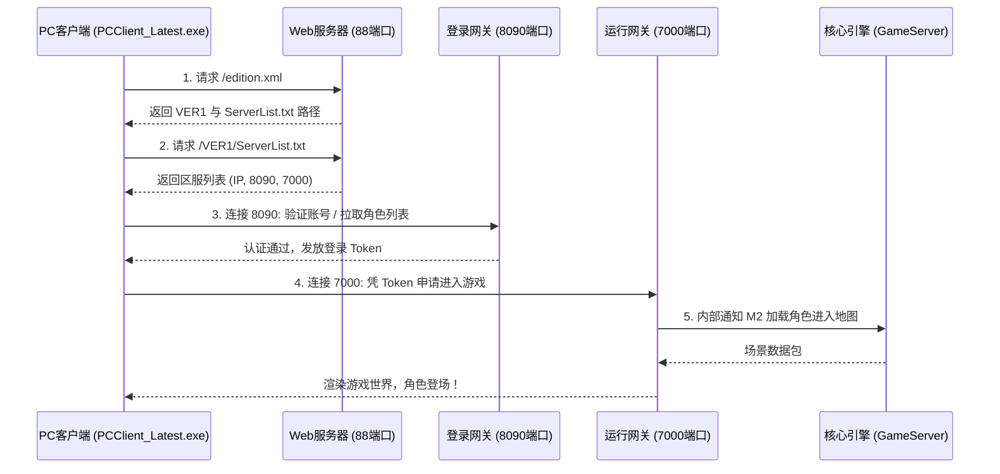

# SKILL-02: 客户端与服务端 IP 协同配置与联调规范

## 技能定位
解决客户端打不开、卡在“正在连接服务器”、选区列表空白或获取不到更新列表的配置规范。

---

## 一、双端网络调用时序全景图



---

## 二、必须统一的 4 个核心文件

若在单机上测试（推荐）：所有 IP 统一填 `127.0.0.1`。  
若在局域网联机：所有 IP 统一填本机的局域网 IP（例如 `192.168.0.102`）。  
若架设公网服务器：统一填公网独立 IP。

### 1. 客户端入口：`accountpassword.xml`
- **路径**：`D:\000GOD\GODclient20261031\assets\res\config\accountpassword.xml`
- **关键配置项**：
  ```xml
  <EDITION URL="http://127.0.0.1:88/edition.xml" />
  ```

### 2. 服务端微端版本定义：`edition.xml`
- **路径**：`D:\000GOD\GODserver20261031\phpstudy_pro\WWW\edition.xml`
- **关键配置项**：
  ```xml
  <VER1 NAME="版本1" URL="http://127.0.0.1:88/VER1/" LIST="http://127.0.0.1:88/VER1" />
  ```

### 3. 服务器选区列表：`ServerList.txt`
- **路径**：`D:\000GOD\GODserver20261031\phpstudy_pro\WWW\VER1\ServerList.txt`
- **格式**：`区服ID|显示名|服务器IP|登录端口(8090)|运行端口(7000)|状态|备注`
- **示例**：
  ```text
  1001|1区|127.0.0.1|8090|7000|11|一区
  ```

### 4. 服务端主控配置：`Config.ini`
- **路径**：`D:\000GOD\GODserver20261031\Mirserver\Config.ini`
- **关键配置项**：
  ```ini
  ExtIPaddr=127.0.0.1
  ```

---

## 三、一键排错 Checklist

- [ ] 浏览器能否打开 `http://<你的IP>:88/edition.xml`？若打不开，检查 Apache 是否启动，88 端口是否被拦截。
- [ ] 浏览器能否下载 `http://<你的IP>:88/VER1/ServerList.txt`？
- [ ] 检查客户端 `debug.log`，若出现 `Connect failed`，检查防火墙是否放行 8090 和 7000 端口。
