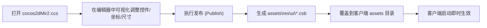

# SKILL-05: Cocos Studio 3.10 UI 工程定制与 CSB 逆向/发布实操

## 技能定位
指导如何使用 Cocos Studio 修改 God 客户端界面（背包、商城、主界面、技能框、聊天栏等），并发布为客户端所需的 `.csb` 二进制文件。

---

## 一、UI 项目工程文件结构

工程源码已提取在：`D:\000GOD\GODcode20261031\client_cocos_ui`
- `cocos2dMir2.ccs`：Cocos Studio 工程总项目配置文件。
- `cocosstudio\`：包含所有 UI 场景（`.csd`）与图集素材（PNG/PLIST）。
  - `173UI\`：核心游戏界面套件。
  - `heroUI\`：英雄界面的专属控件与布局。

---

## 二、可视化修改与导出工作流

### 1. 修改规范
- **命名保持一致**：C++ 客户端代码（如 `UIManagerEx.cpp`、`MainUILayer.cpp`）是通过控件名称在 CSB 树形结构中查找组件的（例如 `btn_close`, `txt_gold`, `img_avatar`）。修改时切勿更改已有控件的 Node Name，否则客户端代码加载控件时会报空指针（nullptr）。
- **坐标系适配**：Cocos2d 默认使用屏幕自适应机制，建议勾选百分比约束与锚点对齐。

### 2. CSB 逆向与调试 (DecCSB)
- 若只有客户端编译好的 `.csb` 文件，而缺少原始 `.csd` 文件：
  可参考 `D:\000GOD\教程和资源\DecCSB逆向视频.mp4` 中的逆向工具，将 FlatBuffers 序列化的 `.csb` 反解为 XML/JSON 结构进行分析。
